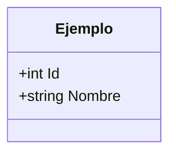

# NNN — Nombre de la feature

- **Estado**: Borrador | Aprobada | Implementada
- **Fecha**: AAAA-MM-DD
- **Capas afectadas**: Model / DataAccess / Business / API / Angular

## 1. Problema y objetivo

_Qué problema resuelve y para quién. Máximo 5 líneas._

## 2. Alcance

**Dentro**
- _…_

**Fuera**
- _…_

## 3. Términos del dominio

_Términos de `CONTEXT.md` usados aquí. Los nuevos se añaden primero a `CONTEXT.md`._

## 4. Reglas de negocio y validaciones

- **RN-01**: _…_
- **VAL-01**: _campo, regla, mensaje de error._

## 5. Contrato de API

| Método | Ruta | Request | Response | Errores |
|---|---|---|---|---|
| _POST_ | _/api/…_ | _DTO_ | _DTO_ | _400, 401, 404, 409_ |

## 6. Modelo de datos

_Entidades y relaciones nuevas o modificadas. Mermaid opcional._

## 7. Pantallas (Angular)

- _Ruta, componente, estados (cargando / vacío / error), acciones._

## 8. Criterios de aceptación

Cada criterio se convierte en al menos un test.

- [ ] **CA-01**: Dado _…_, cuando _…_, entonces _…_.
- [ ] **CA-02**: Dado _…_, cuando _…_, entonces _…_.

## 9. Preguntas abiertas

- _Nada pendiente._
